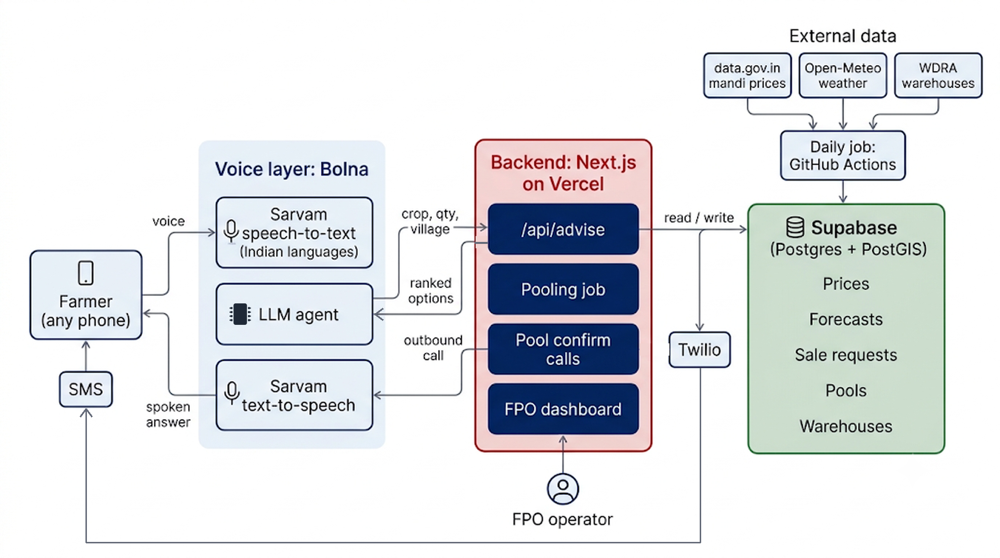

# Mandi Saathi

A phone-based voice agent that tells small farmers what each selling option leaves in their hand, and pools nearby farmers so shared trucks and warehouse loans become reachable.

## The problem

Small and marginal farmers with 10–20 quintals usually sell to the local commission agent or trader at that day's quoted price. Often that trader is the same person who advanced seeds and inputs on credit. The problem statement puts the loss at ₹5,000–20,000 per selling cycle, with 20–30% post-harvest loss from poor storage and timing.

Price information alone does not fix this. Price apps already list rates at other mandis, but a small farmer still cannot use a better price:

- **Transport does not scale down.** A truck costs about the same for 10 quintals as for 50, so a small lot loses most of the price gain at a farther mandi.
- **Storage credit has a floor.** Pledge loans against e-NWR warehouse receipts exist (about 7% p.a. for KCC holders, 75% loan-to-value), but SBI's minimum agricultural pledge loan is ₹1 lakh. One small farmer's lot rarely reaches it.
- **Debt ties the farmer to the trader.** Input credit decides where he sells.

## How it works

### Farmer side

1. The farmer calls a phone number from any phone and speaks in Kannada.
2. The agent asks, one question at a time, for crop, quantity and village, and optionally the amount owed to the trader. Quantities given in bags are converted to quintals after asking the bag weight.
3. The agent confirms the details and calls the backend once.
4. The agent reads up to 3 options, ranked by net take-home after commission, transport, spoilage, warehouse charges and interest. Each option comes with a confidence level. The agent does not recommend one; the decision stays with the farmer.
5. If a shared truck or pooled deposit is possible, the agent asks whether the farmer wants to join.
6. The farmer receives the same numbers by SMS.

### FPO operator side

1. The operator logs in to a web dashboard (works on a phone).
2. The dashboard lists sale requests from the operator's FPO and proposed pools: farmers selling the same crop in the same week within 15 km.
3. The operator reviews a pool, enters pickup date, place and vehicle or warehouse details, and confirms.
4. Confirming triggers outbound calls to each member, who answers yes or no. Members who say yes get an SMS with the details.

## Key features

These are the P0 requirements for the prototype ([PRD §6](docs/PRD.md#6-functional-requirements)).

**Advice call**
- Inbound voice call on Bolna with Kannada speech-to-text and text-to-speech through Sarvam.
- Slot collection one question at a time; debt is optional; bags are converted only after asking bag weight.
- Exactly one tool call per advice. The agent speaks only numbers returned by the backend.
- At most 3 options, best first, each with a confidence phrase, followed by "the decision is yours".
- Stale prices (older than 2 days) are called out.
- Distress handling: the selling flow stops and the Tele-MANAS helpline (14416) is given.

**Advice engine**
- `POST /api/advise` computes options per [CALC_SPEC](docs/CALC_SPEC.md): sell local, sell far alone, sell far pooled, and store + loan for storable crops.
- Future values are P10/P50/P90 ranges; every option carries a confidence label.
- Every request is saved with its inputs and computed options.
- p95 latency under 1.5 s; the route reads only our own database.

**SMS**
- Summary SMS to the caller after each advice call. An SMS failure never fails the call; it is logged.

**Pooling**
- Pool interest is extracted after the call and saved on the request.
- A pooling job groups open requests by crop, sale week and 15 km radius, and proposes a truck pool when the total reaches 60% of truck capacity.

**FPO dashboard**
- Email login; each operator sees only their own FPO's farmers.
- Sale requests list with filters by crop, week and status.
- Proposed pools with members, total quantity and estimated gain per farmer.
- Pool confirmation form that triggers member calls and SMS.

**Data**
- Daily ingestion of mandi prices from data.gov.in, plus a historical backfill used for forecast ranges.

## Architecture



| Component | Role |
|---|---|
| Bolna + Sarvam | Voice layer: speech-to-text, LLM, text-to-speech. Calls the backend tool during the call and posts extractions after it. It only listens and speaks. |
| Next.js on Vercel | API routes for advice, Bolna webhooks, pooling and pool confirmation, plus the FPO dashboard. |
| `lib/calc` | Pure calculation engine. All prices, costs and rankings are computed here, never by the LLM. |
| Supabase | Postgres with PostGIS for spatial queries, Auth for operators, row-level security per FPO. |
| Twilio | Advice and pool-confirmation SMS. |
| GitHub Actions | Daily price ingestion, weekly forecast recompute, pooling trigger every 3 hours. |
| data.gov.in, AGMARKNET | Daily mandi prices and historical exports. |

Details: [docs/ARCHITECTURE.md](docs/ARCHITECTURE.md).

## Tech stack

| Area | Choice |
|---|---|
| Voice | Bolna (agent, telephony), Sarvam (Kannada STT/TTS) |
| App | Next.js (App Router), TypeScript strict, Tailwind |
| Validation | zod |
| Database | Supabase Postgres, PostGIS, Supabase Auth, RLS |
| SMS | Twilio |
| Testing | vitest |
| Hosting | Vercel |
| Scheduled jobs | GitHub Actions |
| Runtime | Node 20+, npm |

## Repository structure

Planned layout. Only `docs/`, `supabase/migrations/` and the root files exist today.

```
mandi-saathi/
├─ AGENTS.md  CLAUDE.md  README.md  .env.example
├─ app/
│  ├─ api/
│  │  ├─ advise/route.ts
│  │  ├─ bolna/call-complete/route.ts
│  │  ├─ bolna/pool-response/route.ts
│  │  ├─ cron/pools/route.ts
│  │  ├─ pools/[id]/confirm/route.ts
│  │  └─ health/route.ts
│  ├─ (dashboard)/            requests, pools, prices pages
│  └─ login/
├─ lib/
│  ├─ calc/                   pure functions, no I/O
│  ├─ data/                   Supabase queries (server-only)
│  ├─ pooling/                grouping algorithm (pure) + persistence
│  ├─ sms/                    Twilio client + message templates
│  ├─ bolna/                  outbound call client, payload types
│  ├─ auth.ts                 secret checks
│  └─ supabase/               server and browser clients
├─ scripts/                   ingest, backfill, forecasts, seed
├─ supabase/migrations/
├─ tests/                     vitest
├─ .github/workflows/         ci, ingest, forecasts, pools
└─ docs/
```

## Getting started

The application code is not written yet. These steps describe the intended setup.

### Prerequisites

- Node 20 or later and npm
- A Supabase project
- Accounts for Bolna, Twilio (trial works; it sends only to verified numbers) and a data.gov.in API key
- Supabase CLI, if you apply the migration from the command line

### Environment

```bash
cp .env.example .env.local
```

Fill in the values:

| Group | Variables |
|---|---|
| Supabase | `NEXT_PUBLIC_SUPABASE_URL`, `NEXT_PUBLIC_SUPABASE_ANON_KEY`, `SUPABASE_SERVICE_ROLE_KEY` (server only) |
| Bolna | `BOLNA_TOOL_SECRET`, `BOLNA_API_KEY`, `BOLNA_POOL_AGENT_ID` |
| Twilio | `TWILIO_SID`, `TWILIO_TOKEN`, `TWILIO_FROM`, `TEST_PHONE` |
| Data | `DATA_GOV_API_KEY`, `DATA_GOV_RESOURCE_ID`, `INGEST_STATE`, `INGEST_DISTRICTS` |
| Jobs | `CRON_SECRET`, `APP_URL` |

Never commit `.env.local` or any other `.env*` file except `.env.example`.

### Database

Apply `supabase/migrations/0001_init.sql` to your project. It enables PostGIS and pgcrypto and creates the tables.

```bash
supabase db push
```

Or paste the file into the Supabase SQL editor.

### Commands

```bash
npm install
npm run dev          # local dev server
npm run lint
npm run typecheck    # tsc --noEmit
npm test             # vitest run
npm run check        # lint + typecheck + test (run before every commit)
npm run db:types     # regenerate lib/supabase/types.ts from Supabase
npm run ingest       # pull daily mandi prices
npm run forecasts    # recompute forecast ranges
npm run backtest     # print forecast coverage
```

## Documentation

| Doc | Contents |
|---|---|
| [PRD](docs/PRD.md) | Problem, users, requirements, metrics, risks |
| [Architecture](docs/ARCHITECTURE.md) | Components, repo layout, data flows, security |
| [API](docs/API.md) | Route contracts and data sources |
| [Calc spec](docs/CALC_SPEC.md) | Every formula, config constant and golden test |
| [Voice agent](docs/VOICE_AGENT.md) | Bolna setup, tools, extractions, test scripts |
| [Bolna prompts](docs/bolna-prompts.md) | Welcome message, agent prompt, hangup prompt |
| [Tasks](docs/TASKS.md) | Build backlog with acceptance criteria |
| [Testing](docs/TESTING.md) | Test layers and data checks |
| [Schema](supabase/migrations/0001_init.sql) | Initial database migration |
| [AGENTS.md](AGENTS.md) | Rules for coding agents and contributors |

## Project status

Prototype in progress for Tech4Bharat (GAVS 2026), Problem 6.1. **All phases implemented.** See [PROGRESS.md](PROGRESS.md) for full progress tracking, [docs/TASKS.md](docs/TASKS.md) for the original backlog, and [docs/superpowers/plans/2026-11-28-mandi-saathi-complete-build.md](docs/superpowers/plans/2026-11-28-mandi-saathi-complete-build.md) for the implementation plan.

### What's built

- **Pure calc engine** (`lib/calc/`) per `docs/CALC_SPEC.md`, all golden tests pass
- **`/api/advise`** route with Bolna secret auth, zod validation, village resolution, SMS
- **SMS module** (`lib/sms/`, Twilio, Kannada templates, failure never fails a request)
- **Bolna webhooks** (`/api/bolna/call-complete`, `/api/bolna/pool-response`, outbound calls)
- **Pooling engine** (`lib/pooling/`, pure grouping + idempotent persistence, cron every 3h)
- **Pool confirm flow** (`/api/pools/[id]/confirm`, Bolna outbound, SMS)
- **FPO dashboard** (Supabase email auth, requests, pools, pool detail + confirm, map, prices)
- **Data pipelines** (`scripts/ingest-prices.ts`, `backfill-prices.ts`, `compute-forecasts.ts`, `backtest.ts`, `seed.ts`)
- **GitHub Actions** (CI, daily ingest, weekly forecasts + backtest, 3h pooling)
- **Tests** (47 tests: calc golden cases, pooling, SMS, mask, vitest)

### What needs real credentials (you)

- Create Supabase project, apply migration, run `npm run db:types` (T0.2)
- Create accounts: Bolna, Twilio trial, data.gov.in API key, Vercel (T0.4)
- Supply real mandi/village/warehouse data with real coordinates, no invented data (T0.3)
- Add secrets to `.env.local` + Vercel + GitHub Actions secrets
- Connect Bolna tool + webhooks (T1.6), verify caller-number + execution-id variables
- Run voice tests 1–7, 9, 10 on a real phone call, log in `docs/test-log.md` (T2.7)
- Run `npm run backtest` against real data, record coverage in `docs/data-notes.md` (T2.5)
- Field validation + demo video + submission (Phase 7)

## Team

Quantum Pickles
